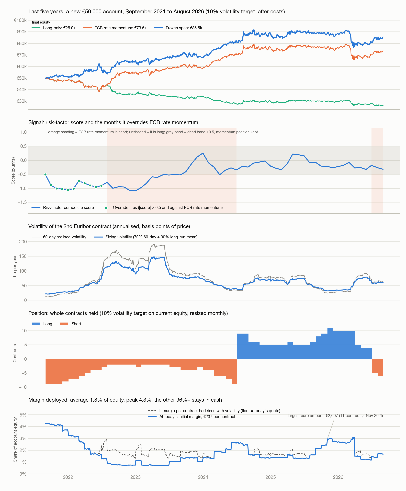
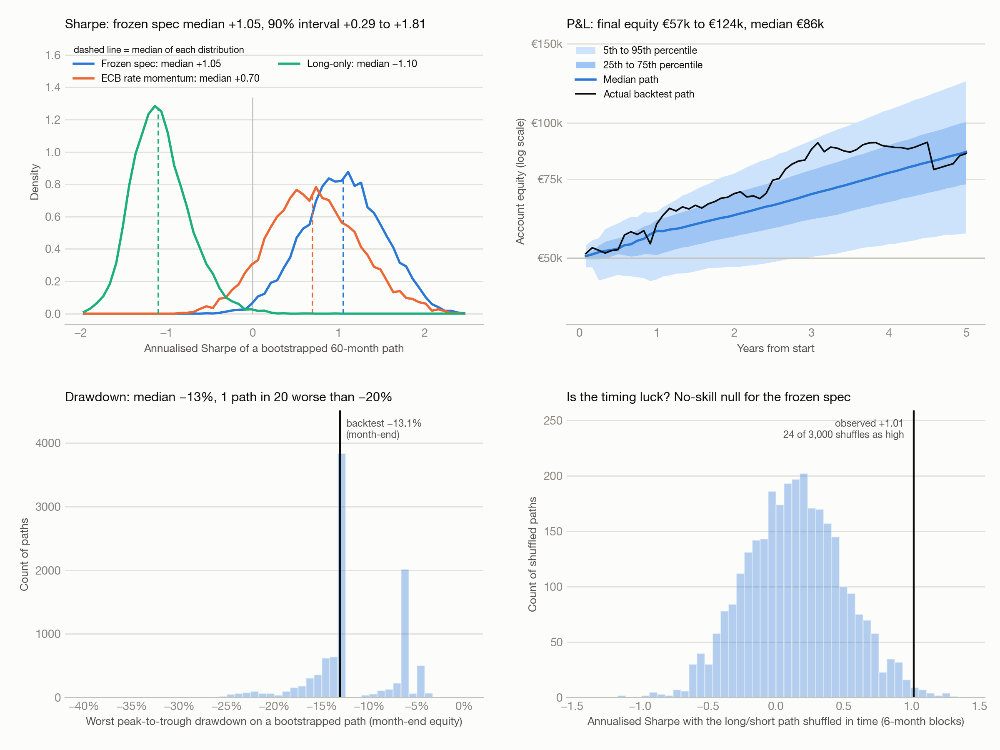
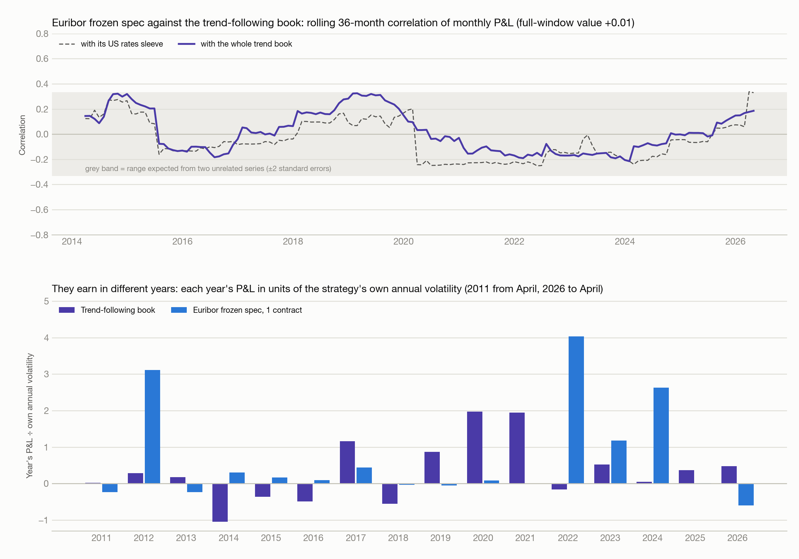

# Euribor macro strategy: appendices to the €50,000 account backtest

Generated with the main report on 7 October 2026 (cost 0.3 bp per side). Appendix A is the last-five-years account (September 2021 to August 2026); Appendix B is the correlation with the trend-following book. Section numbers refer to the main report.

---

# Appendix A. The last five years: September 2021 to August 2026

A new €50,000 account opened on 1 September 2021, same rules, sizing, costs (0.3 bp per side) and margin as the main test. 60 months, covering the 2022–23 hiking cycle, the 2024–25 cuts and the June 2026 hike. The walk-forward threshold is 0.5 in every one of these years, so it is the frozen spec here and is not shown separately. Output: `results/bt50k_5y_*.csv`, figures `results/fig9_bt50k_5y_account.png` and `results/fig10_bt50k_5y_montecarlo.png`. Both pages in one file: `results/bt50k_5y_pages.pdf` (page 1 account, page 2 Sharpe and Monte Carlo analysis).

## A1. Results

| Variant | Sharpe | CAGR | Max DD | Final equity | Sharpe vs long-only |
|---|---|---|---|---|---|
| **Frozen spec, 10% vol target** | **+0.91** | **11.1%** | **−16.4%** | **€85,455** | **+1.87** |
| ECB rate momentum only, 10% vol | +0.66 | 7.9% | −23.9% | €73,540 | +1.61 |
| Long-only, 10% vol (benchmark) | −0.95 | −12.1% | −48.0% | €26,029 | 0 |
| 12M trend, 10% vol (benchmark) | +0.46 | 5.2% | −27.2% | €64,532 | +1.41 |
| Frozen, 5% vol target | +0.96 | 5.9% | −8.5% | €67,014 | +1.92 |
| Frozen, 15% vol target | +0.90 | 16.4% | −24.3% | €108,147 | +1.85 |
| Frozen, 20% vol target | +0.90 | 21.6% | −33.3% | €134,761 | +1.85 |
| Frozen, 60-day vol only | +0.89 | 11.3% | −19.9% | €85,991 | +1.84 |
| Frozen, fixed 1 contract | +1.02 | 4.1% | −4.9% | €61,276 | +1.97 |
| Frozen, fixed 3 contracts | +1.05 | 10.7% | −13.5% | €83,829 | +2.00 |
| ECB rate momentum, fixed 3 contracts | +1.01 | 10.6% | −15.3% | €83,517 | +1.96 |
| Frozen, cost 0.5 bp/side | +0.88 | 10.7% | −17.1% | €83,741 | +1.83 |
| Frozen, cost 1 bp/side | +0.79 | 9.7% | −18.8% | €80,083 | +1.75 |
| Frozen, cost 2 bp/side | +0.65 | 7.8% | −19.8% | €73,355 | +1.60 |

Frozen spec, account detail:

| Measure | Value |
|---|---|
| Total P&L | +€35,455 on €50,000 |
| Realised volatility | 12.4% a year against the 10% target |
| Worst drawdown | −16.4%, from October 2024 to March 2026, not yet recovered at end-August 2026 |
| Worst month / winning months | −13.1% (March 2026) / 68% |
| Contracts held | average 5.4, range 2 to 11 |
| Margin deployed | average €1,284 (1.8% of equity), peak €2,607; peak share 4.3% in September 2021 |
| Costs paid | €2,205 |
| Direction changes | 2 (to long at end-June 2024, to short at end-June 2026); override fired in 11 months, all September 2021 to July 2022 |

By position run:

| Run | Months | 2nd contract move | P&L |
|---|---|---|---|
| Short, Sep 2021 to Jun 2024 | 34 | −410 bp | +€32,214 |
| Long, Jul 2024 to Jun 2026 | 24 | +21 bp | −€1,124 |
| Short, Jul 2026 to Aug 2026 | 2 | −34 bp | +€4,365 |

By calendar year:

| Year | P&L € | Return | Year-end equity | Avg contracts (+ long, − short) | Avg margin, share of equity |
|---|---|---|---|---|---|
| 2021 (Sep–Dec) | +1,279 | +2.6% | 51,279 | −8.7 | 4.0% |
| 2022 | +13,709 | +26.7% | 64,988 | −3.8 | 1.6% |
| 2023 | +2,823 | +4.3% | 67,811 | −2.8 | 1.0% |
| 2024 | +20,065 | +29.6% | 87,876 | +0.5 | 1.8% |
| 2025 | +375 | +0.4% | 88,251 | +6.7 | 1.8% |
| 2026 (Jan–Aug) | −2,796 | −3.2% | 85,455 | +3.9 | 1.9% |

*Figure 9. New €50,000 account from September 2021: equity, signal, volatility, contracts and margin.*

## A2. Sharpe analysis and Monte Carlo

Sharpe by calendar year (2021 = Sep–Dec, 2026 = Jan–Aug):

| Year | Frozen spec, 10% vol | ECB rate momentum, 10% vol | Long-only, 10% vol | Frozen spec, 1 contract | ECB rate momentum, 1 contract |
|---|---|---|---|---|---|
| 2021 | +0.90 | −1.39 | −1.39 | +0.73 | −1.16 |
| 2022 | +1.61 | +0.94 | −1.78 | +1.83 | +1.91 |
| 2023 | +0.40 | +0.51 | −0.28 | +0.51 | +0.51 |
| 2024 | +2.27 | +2.35 | −1.05 | +2.29 | +2.29 |
| 2025 | +0.09 | +0.08 | +0.08 | +0.04 | +0.04 |
| 2026 | −0.25 | −0.27 | −1.42 | +0.39 | +0.39 |
| **All 60 months** | **+0.91** | **+0.66** | **−0.95** | **+1.00** | **+0.99** |

Block bootstrap, 12-month blocks, 10,000 paths of 60 months:

| | Frozen spec | ECB rate momentum | Long-only |
|---|---|---|---|
| Sharpe, 5th / 50th / 95th percentile | +0.29 / +1.05 / +1.81 | −0.12 / +0.70 / +1.60 | −1.56 / −1.10 / −0.48 |
| P(Sharpe > 0) | 99% | 92% | 0% |
| P(beats long-only) / P(beats ECB rate momentum) | 100% / 81% | | |
| Final equity, 5th / 50th / 95th | €57k / €86k / €124k | €45k / €73k / €120k | €18k / €26k / €38k |
| P(ending below €50,000) | 2% | 10% | 100% |
| Max drawdown, median / 5th / 1st percentile | −13% / −20% / −25% | −17% / −31% / −37% | −51% / −65% / −69% |
| First-year P&L, 5th / 50th / 95th | −€5.1k / +€7.4k / +€13.5k | −€5.7k / +€4.6k / +€17.3k | −€11.9k / −€6.6k / +€2.6k |
| P(loss after 1 year) | 20% | 34% | 85% |

No-skill nulls (6-month blocks, because 60 months hold only five 12-month blocks):

| | Observed Sharpe | Null mean | Null 95th pct | p, circular shift | p, block permutation |
|---|---|---|---|---|---|
| Frozen spec | +1.01 | +0.14 | +0.75 | 0 of 48 | 0.008 |
| ECB rate momentum | +0.69 | −0.20 | +0.41 | 0 of 48 | 0.009 |

Deflated Sharpe on 60 months (45 / 70 trials): frozen spec 0.82 / 0.80, ECB rate momentum 0.62 / 0.59. Monthly returns have skew −0.84 and kurtosis 8.5.

*Figure 10. The same four Monte Carlo panels for the 60-month window.*

## A3. Reading

1. **One trade made the money.** 91% of the P&L is the 34-month short through the hiking cycle. The two-year long through the cuts lost €1,124 even though the contract rose 21 bp, because March 2026 cost €11,819 on 10 contracts. The best 5 months are 65% of the P&L.
2. **The override added nothing on equal sizing.** With 3 fixed contracts the frozen spec ends at €83,829 and plain ECB rate momentum at €83,517 (Sharpe +1.05 and +1.01; +1.00 and +0.99 on one contract). The 2nd contract moved −2 bp net over the 11 override months. The gap at a 10% target (+0.91 against +0.66) comes from sizing: the override was short 4 to 9 contracts in the months it gained, and 3 contracts in July 2022, when the contract bounced 49 bp against it.
3. **Fixed contracts beat volatility targeting in this window.** Three fixed contracts made the same money as the 10% target with a −13.5% drawdown instead of −16.4% and a worst month of −6.9% instead of −13.1%. Low volatility in late 2025 took the target to 10 to 11 contracts just before the March 2026 move.
4. **This window is better than typical, not typical.** The rolling 60-month Sharpe of the 2008-start account is +1.00 now against a median of +0.63 across 165 windows (range +0.04 to +1.73); the current window beats 76% of them. Five years with a full hiking cycle and a cutting cycle are the conditions the rule is built for.
5. **Sixty months, three position runs.** The shuffle tests reject luck (p = 0.008), but with 2 direction changes they have little to work with, and the bootstrap interval is wide: +0.29 to +1.81.
6. **Prices are still synthetic here, and this is where they are weakest.** The synthetic takes its forward premium from the AAA government curve, and in 2022–23 short government yields moved away from Euribor-linked rates. Real ICE prices exist for this whole window (Databento, December 2018 onward); rerunning this page on them is the check that matters most.

**Verdict for the window: context-dependent.** If the ECB keeps moving rates, the last five years support the plain ECB rate momentum rule at about Sharpe +1 on fixed contracts; they give no support for the override beyond the sizing effect, and none for volatility targeting over a fixed position. 14 further account variants were run for this page; no parameter was changed.

---

# Appendix B. Correlation with the trend-following book

Does the Euribor strategy add something the rest of the portfolio does not already have? Tested against the AlgoGators trend-following backtest (run `TREND_FOLLOWING_20260505_010930_346`, 34 CME markets, per-market daily P&L in dollars from `trend_risk/.../phase2/pnl_panel.csv`). Window 4 April 2011 to 30 April 2026: 3857 days, 181 months. Euribor side: frozen spec on one contract unless stated. Script `portfolio_correlation.py`, output `results/trendcorr_*.csv`, `results/trendcorr.json`, figure `results/fig11_bt50k_trend_correlation.png`.

## B1. Correlations

Frozen spec, one contract, against the trend book and its sleeves:

| Trend book | Daily (3857) | Weekly (787) | Monthly (181) | Quarterly (61) | Annual (16) |
|---|---|---|---|---|---|
| Whole book | −0.02 | −0.01 | **+0.01** | −0.06 | −0.16 |
| US rates sleeve (ZT, ZF, ZN, UB) | +0.02 | +0.02 | 0.00 | −0.05 | −0.09 |
| Currency sleeve (9 pairs) | +0.02 | +0.07 | +0.09 | −0.04 | −0.71 |
| Everything except rates | −0.03 | −0.02 | +0.01 | −0.05 | −0.15 |

Monthly correlation for the other Euribor versions:

| Euribor version | Whole book | US rates sleeve | Currency sleeve | Everything except rates |
|---|---|---|---|---|
| Frozen spec, 1 contract | +0.01 | 0.00 | +0.09 | +0.01 |
| Frozen spec, €50,000 account (10% vol target) | +0.04 | +0.02 | +0.13 | +0.03 |
| ECB rate momentum, 1 contract | 0.00 | +0.01 | +0.09 | 0.00 |

Monthly correlation by sub-period and its sampling range (block bootstrap, 12-month blocks, 10,000 draws):

| | 2011–15 (57 months) | 2016–20 (60) | 2021–26 (64) | Full window | Bootstrap 5th to 95th percentile |
|---|---|---|---|---|---|
| Whole book | +0.09 | +0.04 | −0.02 | +0.01 | −0.07 to +0.13 |
| US rates sleeve | +0.02 | −0.14 | +0.16 | 0.00 | −0.10 to +0.14 |
| Currency sleeve | | | | +0.09 | −0.02 to +0.25 |

The rolling 36-month correlation with the whole book stays between −0.22 and +0.33 throughout, inside the range two unrelated series would produce (Figure 11, top).

*Figure 11. Rolling 36-month correlation, and each year's P&L for both strategies in units of own volatility.*

## B2. Year by year

P&L in each strategy's own units, and scaled by its own annual volatility so the two are comparable (2011 from April, 2026 to April):

| Year | Trend book $ | Trend book, vol units | Euribor bp | Euribor, vol units |
|---|---|---|---|---|
| 2011 | +1,051 | +0.02 | −12 | −0.23 |
| 2012 | +12,270 | +0.29 | +167 | +3.11 |
| 2013 | +7,754 | +0.18 | −13 | −0.23 |
| 2014 | −44,736 | −1.05 | +16 | +0.31 |
| 2015 | −15,580 | −0.36 | +9 | +0.16 |
| 2016 | −21,000 | −0.49 | +5 | +0.09 |
| 2017 | +49,519 | +1.16 | +24 | +0.44 |
| 2018 | −23,654 | −0.55 | −2 | −0.04 |
| 2019 | +37,388 | +0.87 | −3 | −0.05 |
| 2020 | +84,581 | +1.98 | +4 | +0.08 |
| 2021 | +83,290 | +1.95 | −0 | −0.00 |
| 2022 | −7,008 | −0.16 | +216 | +4.03 |
| 2023 | +22,341 | +0.52 | +63 | +1.18 |
| 2024 | +2,261 | +0.05 | +141 | +2.63 |
| 2025 | +15,763 | +0.37 | +1 | +0.01 |
| 2026 | +20,508 | +0.48 | −32 | −0.60 |

Euribor in the trend book's extreme months:

| Months | Trend book mean | Euribor mean | Euribor months positive |
|---|---|---|---|
| Trend book's 15 worst | −$19,623 | +0.5 bp | 47% |
| Trend book's 15 best | +$29,481 | +3.9 bp | 67% |
| All 181 | +$1,242 | +3.2 bp | 61% |

## B3. Combination

Each stream scaled to the same monthly volatility, then weighted (monthly, April 2011 to April 2026):

| Trend / Euribor risk weight | Sharpe | Worst drawdown, in annual volatilities |
|---|---|---|
| 100 / 0 | +0.35 | −2.43 |
| 80 / 20 | +0.51 | −2.16 |
| 50 / 50 | +0.75 | −1.26 |
| 0 / 100 | +0.72 | −1.02 |

## B4. Reading

**Accepted: the Euribor strategy is uncorrelated with the trend book over the 15 years both exist.** Monthly correlation +0.01, bootstrap range −0.07 to +0.13, the same in three sub-periods, and zero against the book's own US rates sleeve. The two earn in different years: the trend book in 2017 and 2019–21, Euribor in 2012 and 2022–24. A 20% risk weight lifts the combined Sharpe from +0.35 to +0.51.

Caveats:

1. **Uncorrelated, not a hedge.** In the trend book's 15 worst months Euribor averaged +0.5 bp against +3.2 bp in an average month. It does not lose alongside the book, and it does not offset it.
2. **2008–10 is outside the window.** The trend backtest starts in April 2011, so the years of Euribor's largest early profit, when trend strategies in general also did well, cannot be compared.
3. **The combined Sharpe leans on the Euribor Sharpe**, which carries the main report's caveats: synthetic prices, an in-sample threshold, two good ECB cycles. The correlation finding is sturdier than the Sharpe finding, because it does not depend on the level of Euribor returns.
4. **Daily and weekly figures are biased toward zero** by the synthetic's daily noise and by the gap between European and US closes. The monthly figure is the one to use.
5. **The annual correlation with the currency sleeve, −0.71, is 16 points and one cell of 20.** It reflects three years (2012, 2022, 2024) when Euribor earned and the currency sleeve lost; treat it as an observation, not a property.
6. **One trend run.** The comparison uses a single backtest configuration, which held 5 markets on average and US rates on 9% to 21% of days. A trend book with a larger rates allocation, or one that adds European short-rate futures, would overlap more.
7. **Live trading** (October 2025 to May 2026, seven months) is too short to add anything and was not used.
