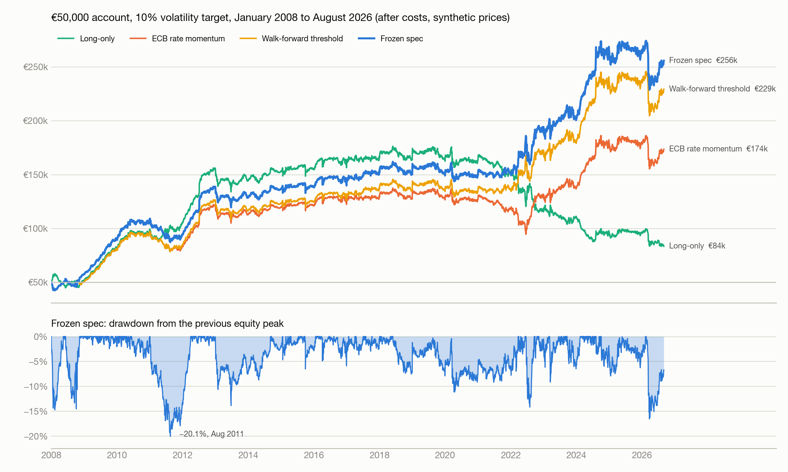
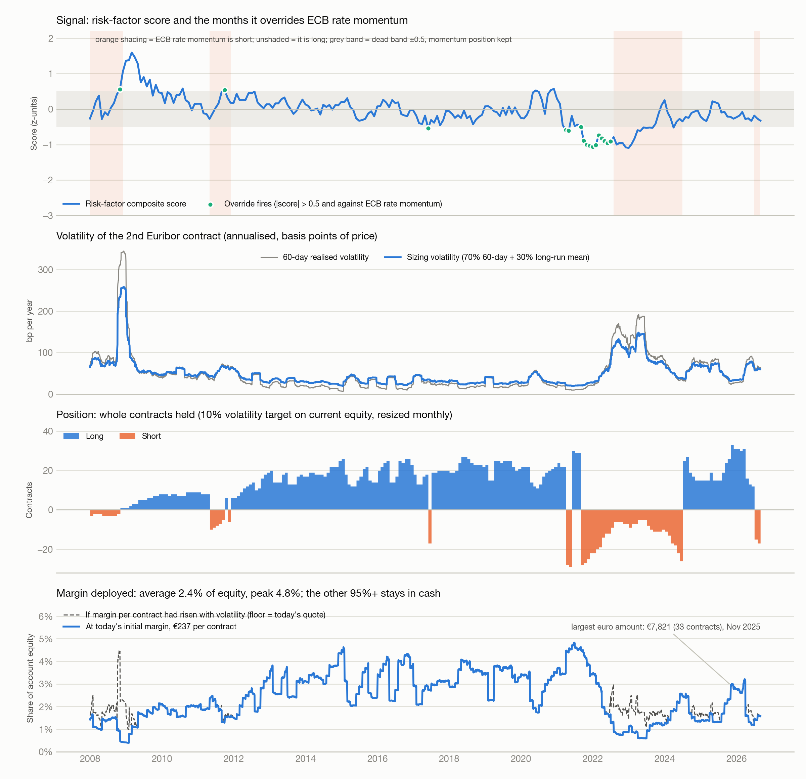
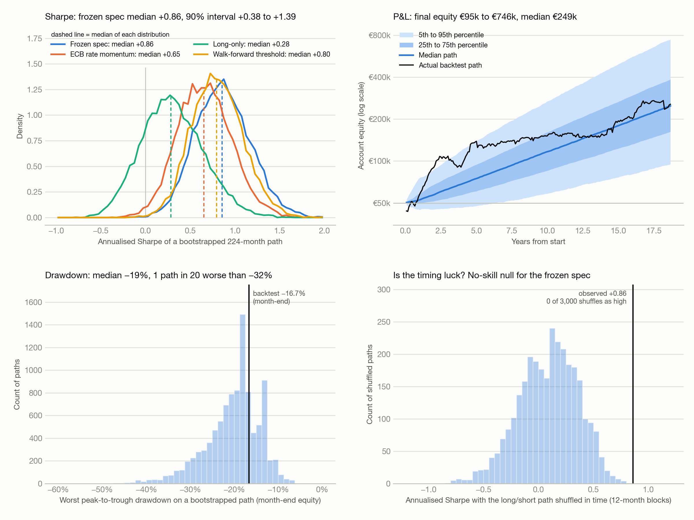

# Euribor macro strategy: €50,000 account backtest

## 1. Hypothesis
The frozen specification earns a positive return on the 2nd quarterly Euribor contract. It has two parts. **ECB rate momentum** sets the default position: long if the deposit facility rate was cut in the last three months, short if it was raised, otherwise the position is kept. **The risk factors** can override it: when the risk-factor score is above +0.5 the position is long, when it is below −0.5 the position is short, whatever the ECB did last. The position is decided at each month-end and held for the next month. This test asks what that edge looks like as a real account: €50,000 of capital, whole contracts, euro costs, margin, and a sizing rule, since the specification itself only says long or short.

**The risk factors.** Three groups of monthly macro series, each turned into a score and averaged into one number:

| Group | What it captures | Series (sign: + argues for a higher futures price, i.e. lower rates) | Publication lag |
|---|---|---|---|
| Rates and policy | where policy and the money-market curve have been moving | deposit rate change over 3 and 6 months (−); 12M minus 3M Euribor slope (+) and its 3-month change (−); 12M Euribor 3-month change (−); 3M Euribor minus the deposit rate (+); 2nd-contract price momentum over 3 and 12 months (+) | none |
| Inflation | whether the ECB has room to ease | headline and core HICP, year on year (−), and their 3-month changes (−); unemployment rate, 6-month change (+) | HICP 1 month, unemployment 2 months |
| Sentiment and stress | financial and political stress that pushes the ECB toward easing | Europe economic policy uncertainty index, level and 3-month change (+); Italy plus Spain minus Germany plus France uncertainty, level and change (+); Italian and Spanish minus German 10-year yield spread, level and change (+); ECB composite systemic stress indicator, level and change (+); economic sentiment indicator, level and change (−) | uncertainty and sentiment 1 month, others none |

Each series is converted to an expanding z-score (at least 36 months of history), clipped to ±3 and multiplied by its sign; the signs were fixed from theory, not fitted. Series are averaged within each group, and the risk-factor score is the mean of the three group scores.

## 2. Benchmark
Long-only, 12-month trend and the plain ECB rate momentum rule, all run through the same account and the same sizing. Window January 2008 to August 2026, 224 months, synthetic 2nd-contract prices. The account starts on 1 January 2008, a month earlier than the earlier reports' 31 January start; that month was a loss, and with the cost change below the frozen spec's one-contract Sharpe goes from +1.09 (earlier reports) to +1.05 here.

Account assumptions:

| Item | Setting |
|---|---|
| Capital | €50,000, euro account, cash earns no interest |
| Contract | €2,500 per price point, €25 per basis point |
| Sizing | contracts = round(10% × equity ÷ (σ × €2,500)), set each month-end with the signal |
| σ | 70% trailing 60-day realised volatility + 30% its long-run mean, annualised |
| Costs | 0.3 bp per side = €7.50 per contract (half a one-tick spread plus exchange, clearing and broker fees); roll = €15 per contract, four times a year |
| Margin | €237 initial margin per contract (broker quote, September 2026), held flat through history |

The 10% volatility target and the volatility blend are my choices, not part of the frozen specification. Section 5 shows what changes with other choices. The 0.3 bp cost is a realistic figure for the ICE contract; 0.5 bp (one full tick) is kept as a sensitivity row and is about what Eurex FEU3 would cost.

## 3. Variants
17 account runs: 5 strategies at the 10% target (frozen, walk-forward threshold, ECB rate momentum, long-only, 12M trend); the frozen spec at 5%, 15% and 20% targets, with unblended 60-day volatility, with 1 and 3 fixed contracts, at 0.5, 1 and 2 bp per side, from a 2002 start, and on the OIS-spliced price series; ECB rate momentum on the OIS-spliced series. No signal parameter was changed or tuned.

## 4. Results

| Variant | Sharpe | CAGR | Max DD | Final equity | Sharpe vs long-only |
|---|---|---|---|---|---|
| **Frozen spec, 10% vol target** | **+0.85** | **9.0%** | **−20.1%** | **€255,769** | **+0.54** |
| Walk-forward threshold, 10% vol | +0.80 | 8.4% | −19.4% | €229,306 | +0.49 |
| ECB rate momentum only, 10% vol | +0.66 | 6.8% | −31.1% | €173,508 | +0.36 |
| Long-only, 10% vol (benchmark) | +0.30 | 2.7% | −52.7% | €83,507 | 0 |
| 12M trend, 10% vol (benchmark) | +0.31 | 2.9% | −35.8% | €85,590 | +0.00 |
| Frozen, 5% vol target | +0.72 | 3.8% | −10.2% | €100,842 | +0.41 |
| Frozen, 15% vol target | +0.80 | 12.6% | −28.8% | €471,227 | +0.50 |
| Frozen, 20% vol target | +0.80 | 17.1% | −36.4% | €999,523 | +0.49 |
| Frozen, 60-day vol only | +0.67 | 8.4% | −26.8% | €230,907 | +0.37 |
| Frozen, fixed 1 contract | +1.00 | 2.8% | −6.5% | €84,408 | +0.70 |
| Frozen, fixed 3 contracts | +0.85 | 6.1% | −18.2% | €153,223 | +0.55 |
| Frozen, cost 0.5 bp/side | +0.79 | 8.3% | −20.1% | €228,110 | +0.49 |
| Frozen, cost 1 bp/side | +0.67 | 6.9% | −20.5% | €177,585 | +0.36 |
| Frozen, cost 2 bp/side | +0.43 | 4.3% | −38.6% | €111,396 | +0.13 |
| Frozen, start Jan 2002 | +0.78 | 8.0% | −20.1% | €345,033 | n/a |
| Frozen, OIS-spliced prices 2005–14 | +0.86 | 9.0% | −18.7% | €257,038 | n/a |
| ECB rate momentum, OIS-spliced prices | +0.64 | 6.5% | −33.1% | €163,595 | n/a |

Frozen spec, account detail:

| Measure | Value |
|---|---|
| Total P&L | +€205,769 on €50,000 |
| Realised volatility | 10.8% a year against the 10% target |
| Worst drawdown | −20.1% (−€45,443 at its deepest in euros), Jan 2011 to Aug 2011, recovered Apr 2012 |
| Longest time under water | 980 trading days |
| Worst month / best month | −13.5% (Mar 2026) / +13.2% (Jul 2012) |
| Winning months | 64% |
| Contracts held | average 15.4, range 1 to 33 as equity grew and volatility fell |
| Costs paid | €22,612, about 10% of gross profit |
| Direction changes | 12 in 18.7 years; position resized in 151 of 224 months |

Margin deployed (Figure 7, bottom panel):

| Period | Avg contracts | Avg margin | Share of equity | Peak share if margin had scaled with volatility |
|---|---|---|---|---|
| 2008–12 | 7.0 | €1,652 | 1.7% | 4.5% |
| 2013–21 | 20.1 | €4,768 | 3.3% | 4.8% |
| 2022–26 | 15.5 | €3,682 | 1.6% | 3.5% |
| Whole window | 15.4 | €3,661 | 2.4% (peak 4.8%) | 4.8% |

Calendar years, frozen spec:

| Year | P&L € | Return | Year-end equity | Avg contracts (+ long, − short) |
|---|---|---|---|---|
| 2008 | +7,647 | +15.3% | 57,647 | −2.0 |
| 2009 | +32,334 | +56.1% | 89,980 | +4.9 |
| 2010 | +18,442 | +20.5% | 108,422 | +8.0 |
| 2011 | −13,859 | −12.8% | 94,563 | −0.2 |
| 2012 | +44,203 | +46.7% | 138,766 | +12.1 |
| 2013 | −10,084 | −7.3% | 128,682 | +15.8 |
| 2014 | +8,304 | +6.5% | 136,986 | +19.7 |
| 2015 | +1,191 | +0.9% | 138,178 | +16.6 |
| 2016 | +1,687 | +1.2% | 139,865 | +21.7 |
| 2017 | +11,763 | +8.4% | 151,628 | +14.9 |
| 2018 | −1,421 | −0.9% | 150,207 | +23.1 |
| 2019 | −1,087 | −0.7% | 149,120 | +22.1 |
| 2020 | +502 | +0.3% | 149,622 | +17.9 |
| 2021 | +2,787 | +1.9% | 152,409 | −0.2 |
| 2022 | +41,928 | +27.5% | 194,338 | −11.6 |
| 2023 | +7,144 | +3.7% | 201,481 | −8.3 |
| 2024 | +62,057 | +30.8% | 263,538 | +1.3 |
| 2025 | +1,498 | +0.6% | 265,036 | +20.1 |
| 2026 (to Aug) | −9,267 | −3.5% | 255,769 | +12.3 |

*Figure 6. Account equity for the four strategies and the frozen spec's drawdown.*

*Figure 7. The signal, the volatility used for sizing, contracts held and margin deployed.*

## 5. Robustness

**Regimes.** The result is regime dependent, not universal.

| Sharpe by period | 2008–12 crisis | 2013–19 ZLB/QE | 2020–21 COVID | 2022–26 hikes + cuts |
|---|---|---|---|---|
| Frozen spec | +1.71 | +0.16 | +0.17 | +0.92 |
| Walk-forward threshold | +1.56 | +0.14 | +0.16 | +0.91 |
| ECB rate momentum | +1.50 | +0.10 | −0.37 | +0.70 |
| Long-only | +1.96 | +0.11 | −0.37 | −0.90 |

63% of the account's growth came in 2008–12, 32% in 2022–26 and 6% in the nine years 2013–21. The best 5 months are 36% of total P&L and the best 10 are 59%.

**Monte Carlo, block bootstrap** (12-month blocks, 10,000 paths of 224 months, account returns):

| | Frozen spec | Walk-forward | ECB rate momentum | Long-only |
|---|---|---|---|---|
| Sharpe, 5th / 50th / 95th percentile | +0.38 / +0.86 / +1.39 | +0.36 / +0.80 / +1.28 | +0.19 / +0.65 / +1.16 | −0.24 / +0.28 / +0.89 |
| P(Sharpe > 0) | 100% | 100% | 99% | 81% |
| P(beats long-only) / P(beats ECB rate momentum) | 97% / 97% | 96% / 93% | | |
| Final equity, 5th / 50th / 95th | €95k / €249k / €746k | €90k / €224k / €623k | €65k / €169k / €504k | €27k / €80k / €284k |
| P(ending below €50,000) | 0.2% | 0.3% | 1.7% | 25% |
| Max drawdown, median / 5th / 1st percentile | −19% / −32% / −39% | −19% / −32% / −39% | −24% / −40% / −48% | −38% / −63% / −72% |
| P(drawdown worse than 20% / 30%) | 44% / 8% | 44% / 7% | 71% / 23% | 96% / 74% |
| First-year P&L, 5th / 50th / 95th | −€5.4k / +€2.7k / +€25.7k | −€5.1k / +€2.4k / +€25.4k | −€6.0k / +€1.9k / +€23.6k | −€9.8k / +€0.3k / +€26.1k |
| P(loss after 1 year / 5 years) | 25% / 8% | 25% / 8% | 34% / 15% | 47% / 39% |

**No-skill nulls** (the long/short path shifted or block-shuffled in time, position sizes left on their dates):

| | Observed Sharpe | Null mean | Null 95th pct | p, circular shift | p, block permutation |
|---|---|---|---|---|---|
| Frozen spec | +0.86 | +0.09 | +0.51 | 0 of 212 | 0 of 3,000 |
| Walk-forward threshold | +0.80 | +0.10 | +0.52 | 0.005 | 0.001 |
| ECB rate momentum | +0.66 | +0.14 | +0.51 | 0.042 | 0.007 |

**Deflated Sharpe** (expected best-of-N Sharpe under the null: 0.53 for 45 trials, 0.57 for 70): frozen spec 0.91 / 0.88, walk-forward threshold 0.86 / 0.82, ECB rate momentum 0.70 / 0.65, long-only 0.17 / 0.13. Monthly returns have skew −0.39 and kurtosis 7.0.

*Figure 8. Bootstrap Sharpe with medians, bootstrap equity paths, bootstrap drawdown, and the no-skill shuffle test.*

**Sizing.** Volatility targeting costs Sharpe here: +1.00 with one fixed contract against +0.85 at a 10% target, because the strategy earns most when volatility is high, which is when the target cuts the position. Without the long-run blend the account ran up to 73 contracts in the zero-rate years and Sharpe fell to +0.67. Higher targets scale return and drawdown together (20% target: −36.4% drawdown, a −27% month).

**Costs.** Sharpe +0.79 at 0.5 bp per side (one full tick), +0.67 at 1 bp and +0.43 at 2 bp. Rolls are 76% of the contract-sides traded: at a 10% target the account rolls about 15 contracts four times a year, against 12 direction changes in 18.7 years.

**Instrument.** On the OIS-spliced prices for 2005–14 the frozen spec is +0.86 (€257k) against +0.85 (€256k); ECB rate momentum goes from +0.66 to +0.64.

**Margin.** Margin is never the constraint. It averaged 2.4% of equity and peaked at 4.8%; even with margin scaled up with volatility the peak stays at 4.8%. The binding limit is the volatility target, and 95% of the account sits in cash, which this backtest credits no interest on.
