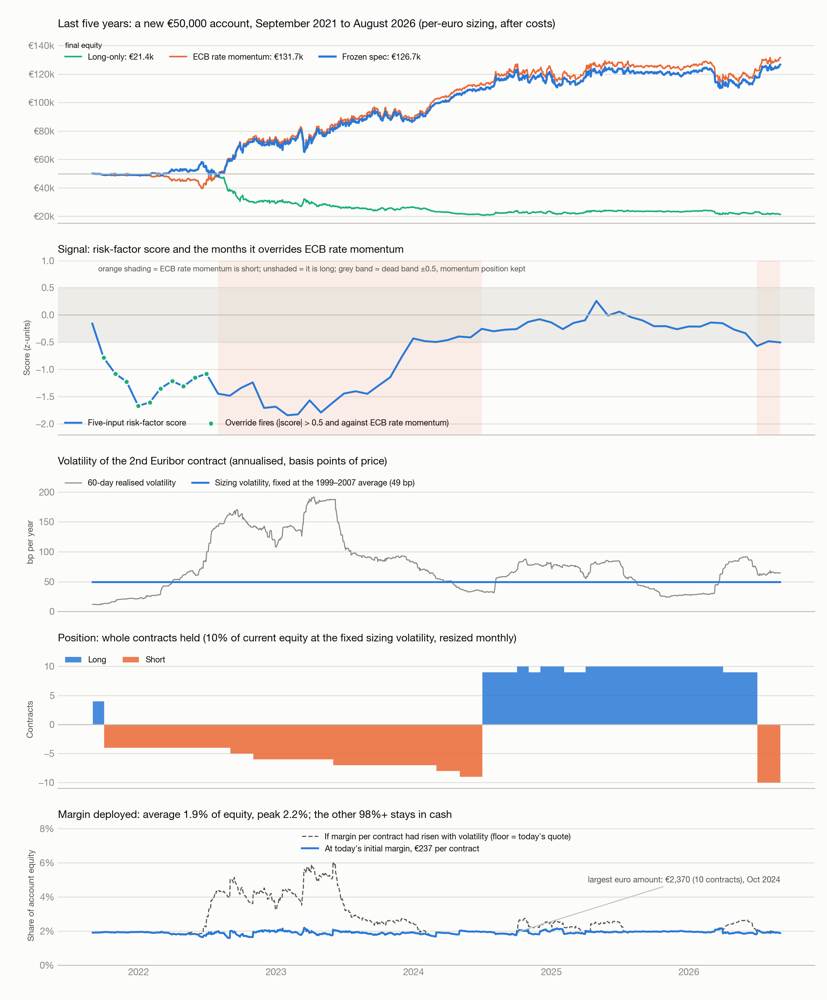
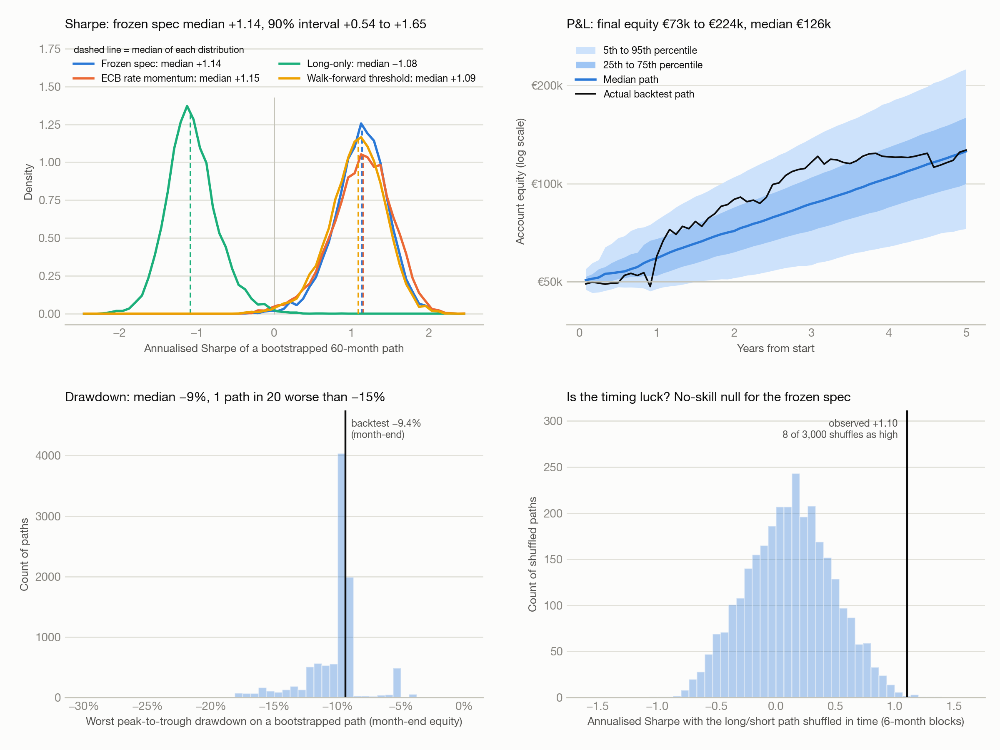
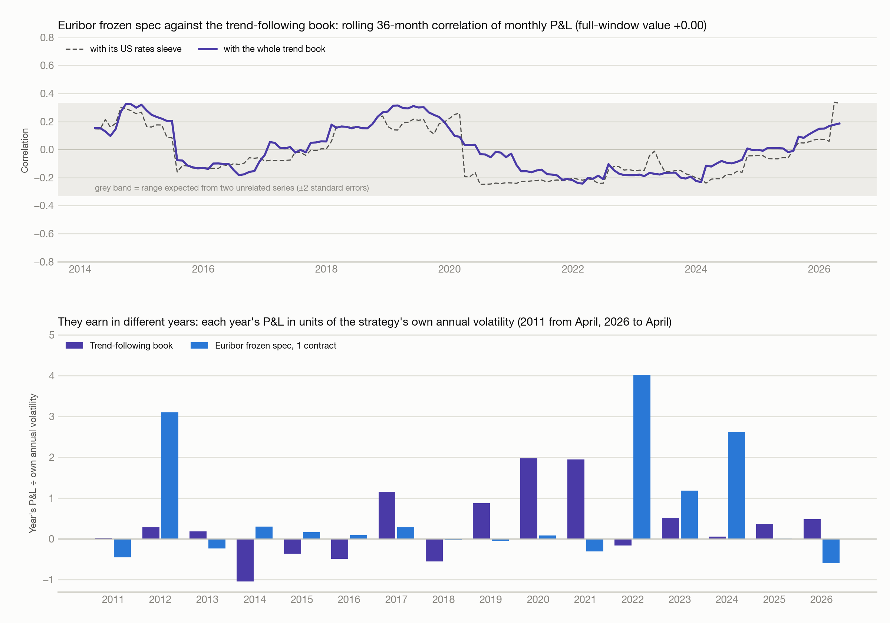

# Euribor macro strategy: appendices to the €50,000 account backtest

Generated with the main report on 28 October 2026 (cost 0.3 bp per side). Appendix A is the last-five-years account (September 2021 to August 2026); Appendix B is the correlation with the trend-following book. Section numbers refer to the main report.

---

# Appendix A. The last five years: September 2021 to August 2026

A new €50,000 account opened on 1 September 2021, with the same rules, sizing (σ = 49 bp, so 4 contracts at the start), costs (0.3 bp per side), cash interest and margin as the main test. 60 months, covering the 2022–23 hiking cycle, the 2024–25 cuts and the June 2026 hike. The walk-forward threshold is 0.3 in these years, not 0.5, so it is shown separately. Output: `results/bt50k_5y_*.csv`, figures `reports/figures/fig9_bt50k_5y_account.png` and `reports/figures/fig10_bt50k_5y_montecarlo.png`. Both pages in one file: `reports/figures/bt50k_5y_pages.pdf` (page 1 account, page 2 Sharpe and Monte Carlo analysis).

## A1. Results

| Variant | Sharpe | CAGR | Max DD | Final equity | Sharpe vs long-only |
|---|---|---|---|---|---|
| **Frozen spec, per-euro sizing** | **+1.00** | **20.1%** | **−19.5%** | **€126,680** | **+1.94** |
| Walk-forward threshold, per-euro sizing | +0.96 | 19.3% | −19.5% | €122,320 | +1.91 |
| ECB rate momentum only, per-euro sizing | +1.03 | 21.0% | −20.8% | €131,709 | +1.97 |
| Long-only, per-euro sizing (benchmark) | −0.94 | −15.4% | −58.4% | €21,353 | 0 |
| 12M trend, per-euro sizing (benchmark) | +0.74 | 14.6% | −20.8% | €100,014 | +1.68 |
| v1 spec, 10% vol target, no interest (as reported) | +0.91 | 11.1% | −16.4% | €85,455 | +1.86 |
| v1 spec, per-euro sizing | +1.06 | 21.2% | −18.9% | €132,508 | +2.00 |
| Frozen, 10% vol target | +0.82 | 12.3% | −16.6% | €90,151 | +1.76 |
| ECB rate momentum, 10% vol target | +0.67 | 10.3% | −24.3% | €82,153 | +1.61 |
| Frozen, 10% vol target, 60-day vol only | +0.65 | 9.9% | −19.6% | €80,690 | +1.59 |
| Frozen, 5% risk per euro | +0.96 | 10.8% | −12.4% | €84,141 | +1.91 |
| Frozen, 15% risk per euro | +0.99 | 29.0% | −29.1% | €181,933 | +1.93 |
| Frozen, 20% risk per euro | +0.99 | 37.1% | −38.3% | €248,456 | +1.93 |
| Frozen, fixed 1 contract | +0.99 | 6.0% | −5.0% | €67,364 | +1.93 |
| Frozen, fixed 3 contracts | +1.01 | 12.6% | −13.9% | €91,229 | +1.95 |
| ECB rate momentum, fixed 3 contracts | +1.01 | 12.7% | −15.7% | €91,947 | +1.95 |
| Frozen, no interest on cash | +1.02 | 18.1% | −19.6% | €116,318 | +1.97 |
| Frozen, cost 0.5 bp/side | +0.97 | 19.5% | −19.7% | €123,736 | +1.92 |
| Frozen, cost 1 bp/side | +0.91 | 18.4% | −20.0% | €118,124 | +1.86 |
| Frozen, cost 2 bp/side | +0.81 | 16.6% | −21.1% | €109,131 | +1.76 |

Frozen spec, account detail:

| Measure | Value |
|---|---|
| Total P&L | +€76,680 on €50,000: +€65,944 trading, +€10,736 interest |
| Realised volatility | 17.8% a year |
| Worst drawdown | −19.5%, from March 2023 to March 2023, recovered April 2023 |
| Worst month / winning months | −9.4% (March 2026) / 67% |
| Contracts held | average 7.5, range 4 to 10 |
| Margin deployed | average €1,768 (1.9% of equity), peak €2,370; peak share 2.2% in March 2023 |
| Costs paid | €2,670 |
| Direction changes | 3 (to short at end-September 2021, to long at end-June 2024, to short at end-June 2026); override fired in 10 months, September 2021 to June 2022 |

By position run:

| Run | Months | 2nd contract move | Trading P&L |
|---|---|---|---|
| Long, Sep 2021 to Sep 2021 | 1 | −6 bp | −€689 |
| Short, Oct 2021 to Jun 2024 | 33 | −404 bp | +€56,598 |
| Long, Jul 2024 to Jun 2026 | 24 | +21 bp | +€1,633 |
| Short, Jul 2026 to Aug 2026 | 2 | −34 bp | +€8,401 |

By calendar year:

| Year | Trading P&L € | Interest € | Return | Year-end equity | Avg contracts (+ long, − short) | Avg margin, share of equity |
|---|---|---|---|---|---|---|
| 2021 (Sep–Dec) | −726 | −94 | −1.6% | 49,180 | −2.0 | 1.9% |
| 2022 | +24,739 | +53 | +50.4% | 73,972 | −4.5 | 1.8% |
| 2023 | +10,371 | +2,660 | +17.6% | 87,003 | −6.6 | 1.9% |
| 2024 | +27,224 | +3,948 | +35.8% | 118,175 | +0.8 | 1.9% |
| 2025 | +424 | +2,588 | +2.5% | 121,187 | +9.8 | 1.9% |
| 2026 (Jan–Aug) | +3,911 | +1,582 | +4.5% | 126,680 | +4.4 | 1.9% |

*Figure 9. New €50,000 account from September 2021: equity, signal, volatility, contracts and margin.*

## A2. Sharpe analysis and Monte Carlo

Sharpe over cash by calendar year (2021 = Sep–Dec, 2026 = Jan–Aug):

| Year | Frozen spec | Walk-forward | ECB rate momentum | Long-only | Frozen spec, 1 contract | ECB rate momentum, 1 contract |
|---|---|---|---|---|---|---|
| 2021 | −1.04 | −1.04 | −1.17 | −1.17 | −1.02 | −1.16 |
| 2022 | +1.88 | +1.88 | +1.88 | −1.86 | +1.83 | +1.91 |
| 2023 | +0.63 | +0.63 | +0.62 | −0.46 | +0.51 | +0.51 |
| 2024 | +2.21 | +2.21 | +2.33 | −1.25 | +2.29 | +2.29 |
| 2025 | +0.08 | +0.08 | +0.09 | +0.09 | +0.04 | +0.04 |
| 2026 | +0.40 | +0.02 | +0.43 | −0.99 | +0.39 | +0.39 |
| **All 60 months** | **+1.00** | **+0.96** | **+1.03** | **−0.94** | **+0.97** | **+0.99** |

No-skill nulls (6-month blocks, because 60 months hold only five 12-month blocks):

| | Observed Sharpe | Null mean | Null 95th pct | p, circular shift | p, block permutation |
|---|---|---|---|---|---|
| Frozen spec | +1.10 | +0.12 | +0.73 | 0 of 48 | 0.003 |
| ECB rate momentum | +1.14 | −0.14 | +0.50 | 0 of 48 | 0 of 3,000 |

Block bootstrap, 12-month blocks, 10,000 paths of 60 months (resampling this window's own months):

| | Frozen spec | Walk-forward | ECB rate momentum | Long-only |
|---|---|---|---|---|
| Sharpe, 5th / 50th / 95th percentile | +0.54 / +1.14 / +1.65 | +0.43 / +1.09 / +1.63 | +0.44 / +1.15 / +1.73 | −1.56 / −1.08 / −0.48 |
| P(beats long-only) / P(beats ECB rate momentum) | 100% / 35% | 100% / 26% | | |
| Final equity, 5th / 50th / 95th | €73k / €126k / €224k | €68k / €121k / €222k | €68k / €129k / €274k | €10k / €22k / €41k |
| P(ending below €50,000) | 0% | 0% | 0% | 99% |
| Max drawdown, median / 5th / 1st percentile | −9% / −15% / −18% | −9% / −16% / −18% | −11% / −18% / −20% | −59% / −80% / −86% |
| First-year P&L, 5th / 50th / 95th | −€2.4k / +€9.1k / +€27.3k | −€3.0k / +€8.4k / +€27.3k | −€2.4k / +€8.6k / +€39.9k | −€20.6k / −€6.4k / +€4.0k |
| P(loss after 1 year) | 10% | 17% | 15% | 84% |

Deflated Sharpe on 60 months (50 / 105 trials): frozen spec 0.89 / 0.85, ECB rate momentum 0.92 / 0.88. Monthly returns have skew +1.55 and kurtosis 10.2.

*Figure 10. The same four Monte Carlo panels for the 60-month window.*

## A3. Reading

1. **One trade made the money.** 86% of the trading P&L is the 33-month short from October 2021 to June 2024. The 24-month long through the cuts made only €1,633 although the contract rose 21 bp, because March 2026 cost €11,819 on 10 contracts. The best 5 months are 59% of the trading P&L.
2. **The override cost money here.** The frozen spec ends at €126,680 and ECB rate momentum alone at €131,709 (Sharpe +1.00 and +1.03; +0.97 and +0.99 on one contract). The override was short 4 contracts in its 10 months, over which the 2nd contract moved +4 bp; July 2022 alone cost €4,947 on 4 contracts as the contract bounced 49 bp. At the v1 10% target the same override looks like a gain (+0.82 against +0.67), because 2021's low volatility put on more contracts while the shorts paid.
3. **Per-euro sizing beat the volatility target in this window.** Sharpe +1.00 against +0.82 on the same signals. The worst month was March 2026, −9.4% on 10 contracts; v1 as reported lost 13.1% in its worst month, March 2026, after calm markets in late 2025 had taken its volatility target to as many as 11 contracts.
4. **This window is better than typical, not typical.** The rolling 60-month Sharpe of the 2008-start account is +1.09 now against a median of +0.72 across 165 windows (range −0.10 to +1.75); the current window beats 82% of them. Five years with a full hiking cycle and a cutting cycle are the conditions the rule is built for.
5. **Sixty months, 4 position runs.** The shuffle tests reject luck (p = 0.003), but with 3 direction changes they have little to work with, and the bootstrap interval is wide: +0.54 to +1.65.
6. **Prices are still synthetic here, and this is where they are weakest.** The synthetic takes its forward premium from the AAA government curve, and in 2022–23 short government yields moved away from Euribor-linked rates. Real ICE prices exist for this whole window (Databento, December 2018 onward); rerunning this page on them is the check that matters most.

**Verdict for the window: context-dependent.** If the ECB keeps moving rates, the last five years support ECB rate momentum at about Sharpe +1 with size fixed per euro; they give no support for the override. 20 account variants were run for this page; no parameter was changed.

---

# Appendix B. Correlation with the trend-following book

Does the Euribor strategy add something the rest of the portfolio does not already have? Tested against the AlgoGators trend-following backtest (run `TREND_FOLLOWING_20260505_010930_346`, 34 CME markets, per-market daily P&L in dollars from `trend_risk/.../phase2/pnl_panel.csv`). Window 4 April 2011 to 30 April 2026: 3857 days, 181 months. Euribor side: frozen spec (v2) on one contract unless stated. Script `research/trend_correlation.py`, output `results/trendcorr_*.csv`, `results/trendcorr.json`, figure `reports/figures/fig11_bt50k_trend_correlation.png`.

## B1. Correlations

Frozen spec, one contract, against the trend book and its sleeves:

| Trend book | Daily (3857) | Weekly (787) | Monthly (181) | Quarterly (61) | Annual (16) |
|---|---|---|---|---|---|
| Whole book | −0.02 | −0.01 | **0.00** | −0.07 | −0.19 |
| US rates sleeve (ZT, ZF, ZN, UB) | +0.02 | +0.02 | +0.01 | −0.04 | −0.08 |
| Currency sleeve (9 pairs) | +0.01 | +0.06 | +0.08 | −0.04 | −0.70 |
| Everything except rates | −0.03 | −0.02 | 0.00 | −0.06 | −0.18 |

Monthly correlation for the other Euribor versions:

| Euribor version | Whole book | US rates sleeve | Currency sleeve | Everything except rates |
|---|---|---|---|---|
| Frozen spec, 1 contract | 0.00 | +0.01 | +0.08 | 0.00 |
| Frozen spec, €50,000 account (per-euro sizing, over cash) | 0.00 | +0.01 | +0.08 | 0.00 |
| ECB rate momentum, 1 contract | 0.00 | +0.01 | +0.09 | 0.00 |

Monthly correlation by sub-period and its sampling range (block bootstrap, 12-month blocks, 10,000 draws):

| | 2011–15 (57 months) | 2016–20 (60) | 2021–26 (64) | Full window | Bootstrap 5th to 95th percentile |
|---|---|---|---|---|---|
| Whole book | +0.09 | +0.04 | −0.03 | 0.00 | −0.08 to +0.13 |
| US rates sleeve | +0.04 | −0.12 | +0.16 | +0.01 | −0.09 to +0.15 |
| Currency sleeve | | | | +0.08 | −0.02 to +0.24 |

The rolling 36-month correlation with the whole book stays between −0.24 and +0.32 throughout, inside the range two unrelated series would produce (Figure 11, top).

*Figure 11. Rolling 36-month correlation, and each year's P&L for both strategies in units of own volatility.*

## B2. Year by year

P&L in each strategy's own units, and scaled by its own annual volatility so the two are comparable (2011 from April, 2026 to April):

| Year | Trend book $ | Trend book, vol units | Euribor bp | Euribor, vol units |
|---|---|---|---|---|
| 2011 | +1,051 | +0.02 | −24 | −0.45 |
| 2012 | +12,270 | +0.29 | +167 | +3.10 |
| 2013 | +7,754 | +0.18 | −13 | −0.23 |
| 2014 | −44,736 | −1.05 | +16 | +0.31 |
| 2015 | −15,580 | −0.36 | +9 | +0.16 |
| 2016 | −21,000 | −0.49 | +5 | +0.09 |
| 2017 | +49,519 | +1.16 | +15 | +0.28 |
| 2018 | −23,654 | −0.55 | −2 | −0.04 |
| 2019 | +37,388 | +0.87 | −3 | −0.05 |
| 2020 | +84,581 | +1.98 | +4 | +0.08 |
| 2021 | +83,290 | +1.95 | −16 | −0.30 |
| 2022 | −7,008 | −0.16 | +216 | +4.02 |
| 2023 | +22,341 | +0.52 | +63 | +1.18 |
| 2024 | +2,261 | +0.05 | +141 | +2.62 |
| 2025 | +15,763 | +0.37 | +1 | +0.01 |
| 2026 | +20,508 | +0.48 | −32 | −0.59 |

Euribor in the trend book's extreme months:

| Months | Trend book mean | Euribor mean | Euribor months positive |
|---|---|---|---|
| Trend book's 15 worst | −$19,623 | +0.5 bp | 47% |
| Trend book's 15 best | +$29,481 | +3.5 bp | 53% |
| All 181 | +$1,242 | +3.0 bp | 58% |

## B3. Combination

Each stream scaled to the same monthly volatility, then weighted (monthly, April 2011 to April 2026):

| Trend / Euribor risk weight | Sharpe | Worst drawdown, in annual volatilities |
|---|---|---|
| 100 / 0 | +0.35 | −2.43 |
| 80 / 20 | +0.50 | −2.16 |
| 50 / 50 | +0.72 | −1.26 |
| 0 / 100 | +0.68 | −1.08 |

## B4. Reading

**Accepted: the Euribor strategy is uncorrelated with the trend book over the 15 years both exist.** Monthly correlation 0.00, bootstrap range −0.08 to +0.13, the same in three sub-periods, and zero against the book's own US rates sleeve. The two earn in different years: the trend book in 2017 and 2019–21, Euribor in 2012 and 2022–24. A 20% risk weight lifts the combined Sharpe from +0.35 to +0.50.

Caveats:

1. **Uncorrelated, not a hedge.** In the trend book's 15 worst months Euribor averaged +0.5 bp against +3.0 bp in an average month. It does not lose alongside the book, and it does not offset it.
2. **2008–10 is outside the window.** The trend backtest starts in April 2011, so the years of Euribor's largest early profit, when trend strategies in general also did well, cannot be compared.
3. **The combined Sharpe leans on the Euribor Sharpe**, which carries the main report's caveats: synthetic prices, a score chosen after the review, two good ECB cycles. The correlation finding is sturdier than the Sharpe finding, because it does not depend on the level of Euribor returns.
4. **Daily and weekly figures are biased toward zero** by the synthetic's daily noise and by the gap between European and US closes. The monthly figure is the one to use.
5. **The annual correlation with the currency sleeve, −0.70, is 16 points and one cell of 20.** It reflects three years (2012, 2022, 2024) when Euribor earned and the currency sleeve lost; treat it as an observation, not a property.
6. **One trend run.** The comparison uses a single backtest configuration, which held 5 markets on average and US rates on 9% to 21% of days. A trend book with a larger rates allocation, or one that adds European short-rate futures, would overlap more.
7. **Live trading** (October 2025 to May 2026, seven months) is too short to add anything and was not used.
