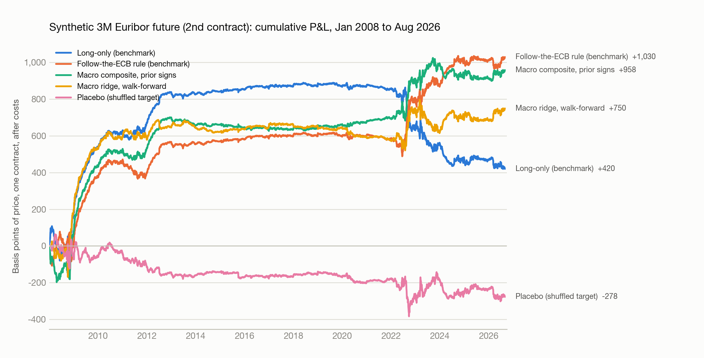
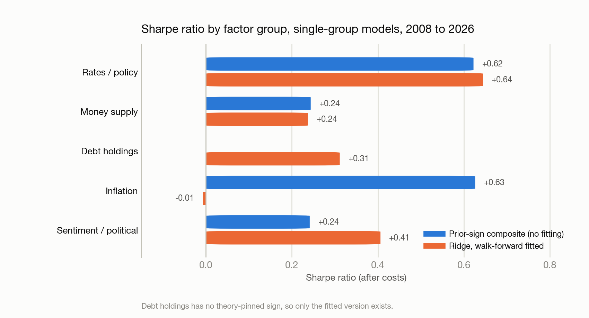

# Euribor 3M futures: macro-factor direction strategy

Backtest report, 24 September 2026. Instrument: synthetic 3-month Euribor future, second quarterly contract (3 to 6 months to expiry). Monthly rebalancing at month-end, positions applied from the next trading day, half a basis point (one tick) per side plus quarterly roll costs. Out-of-sample window for every variant: January 2008 to August 2026 (224 months). Data and construction are in the appendix.

## 1. Hypothesis

The direction of the 3M Euribor future over the next month is predictable from the ECB's reaction function: policy-rate momentum and the money-market curve (rates), M1/M3 growth and the Eurosystem balance sheet (money supply), euro-area banks' holdings of euro versus foreign or dollar debt (debt holdings), and political or policy stress measured by news-based policy-uncertainty indices, periphery sovereign spreads and systemic-stress gauges (sentiment). Inflation is added as an explicit extension because it is the ECB's mandate variable and the natural bar for the other factors.

## 2. Benchmark

- **Primary benchmark: follow-the-ECB.** Hold the future long if the deposit rate was cut in the last three months, short if it was raised, keep the previous position otherwise. This is the simplest thing a rates trader would do and it turns out to be hard to beat.
- **Secondary benchmarks:** long-only (roll the second contract), 3-month and 12-month price trend.
- **Universe and window:** one instrument, daily P&L in basis points of price, Jan 2008 to Aug 2026. Fitted models train on data from Dec 2001 onward with an expanding window (minimum 72 months), refit every month, and never see the month they predict. The 2002 to 2007 period is reported separately as a quasi-in-sample check for the unfitted rules.

## 3. Variants

45 variants were run in total (all rows are in `results/results_main.csv`). They fall into four families:

| Family | What varies | Count |
|---|---|---|
| Benchmarks | long-only, 3M trend, 12M trend, follow-the-ECB | 4 |
| Prior-sign composite (no fitting) | z-score each feature, multiply by its theory sign, average within and across groups; ±1 vs scaled sizing; with and without inflation; single group and drop-one-group; expanding vs rolling 60M z-scores; front, 2nd, 3rd contract; 3M smoothed signal; 1 bp and 2 bp costs | 17 |
| Fitted, walk-forward | ridge (α = 1, 10, 100, 1000), lasso, logistic; ±1 vs scaled; user factors only; single group and drop-one-group; plus US rates and Treasury holdings; 10-year minimum training; front contract; shuffled-target placebo | 20 |
| Combinations | composite averaged with ridge; composite averaged with follow-the-ECB | 2 |

Debt-holdings features have no theory-pinned sign, so they enter only the fitted models. Full feature list with lags and signs: appendix B.

## 4. Results

| Variant | Sharpe | Ann. P&L (bp) | Max DD (bp) | CAGR @10% vol | Max DD @10% vol | Monthly hit | Δ Sharpe vs follow-the-ECB |
|---|---|---|---|---|---|---|---|
| Benchmark: long-only, 2nd contract | +0.27 | +18 | -470 | +2.2% | -52% | 56% | -0.58 |
| Benchmark: 12M trend | +0.50 | +35 | -243 | +4.6% | -32% | 54% | -0.35 |
| Benchmark: 3M trend | +0.13 | +9 | -354 | +0.8% | -42% | 54% | -0.72 |
| Benchmark: follow-the-ECB (policy momentum) | +0.85 | +58 | -162 | +8.3% | -23% | 60% | +0.00 |
| Macro composite, prior signs, ±1 | +0.79 | +55 | -140 | +7.7% | -19% | 61% | -0.05 |
| Macro composite, prior signs, scaled | +1.14 | +43 | -82 | +11.5% | -21% | 57% | +0.29 |
| Macro composite, prior signs, no inflation | +0.72 | +49 | -188 | +6.9% | -26% | 55% | -0.13 |
| Ridge, all 37 features, α=10, ±1 | +0.58 | +40 | -194 | +5.4% | -25% | 54% | -0.27 |
| Ridge, α=100, ±1 | +0.69 | +48 | -217 | +6.6% | -27% | 56% | -0.16 |
| Ridge, α=10, scaled | +0.99 | +76 | -230 | +9.9% | -27% | 51% | +0.15 |
| Logistic direction, ±1 | +0.67 | +46 | -188 | +6.4% | -24% | 57% | -0.18 |
| Lasso, ±1 | +0.42 | +29 | -276 | +3.8% | -34% | 54% | -0.43 |
| Ridge, user factors only (no inflation) | +0.48 | +33 | -215 | +4.4% | -29% | 53% | -0.36 |
| Ridge + US rates + Treasury holdings (from 2009) | +0.20 | +10 | -263 | +1.5% | -40% | 52% | -0.65 |
| Combo: composite + ridge (post hoc) | +0.93 | +49 | -106 | +9.3% | -19% | 62% | +0.09 |
| Combo: composite + follow-the-ECB (post hoc) | +1.30 | +59 | -106 | +13.3% | -22% | 73% | +0.45 |
| Placebo: ridge on shuffled target | -0.21 | -15 | -447 | -2.6% | -51% | 48% | -1.06 |

CAGR and drawdown at 10% volatility are ex-post scalings of the same P&L to a common risk level, so they are comparable across rows but are not what one unlevered contract earns. The two combination rows were formed after seeing the single-model results and should be read as candidates, not findings.

**Which factor groups carry the result.** Single-group models and drop-one ablations, Sharpe after costs:

| Group | Alone, prior signs | Alone, ridge | Composite without it | Ridge without it |
|---|---|---|---|---|
| Rates / policy | +0.62 | +0.64 | +0.57 | +0.35 |
| Money supply | +0.24 | +0.24 | +0.81 | +0.55 |
| Debt holdings | n/a | +0.31 | n/a | +0.48 |
| Inflation (added) | +0.63 | -0.01 | +0.72 | +0.48 |
| Sentiment / political | +0.24 | +0.41 | +0.76 | +0.58 |

Reference: composite with all groups +0.79, ridge with all groups +0.58.

## 5. Robustness

**Sub-periods (Sharpe).** The edge is regime-dependent, not universal: it appears when the ECB is moving (2008 to 2012, 2022 to 2026) and vanishes at the zero lower bound (2013 to 2019), where the contract barely moved and the monthly hit rate was a coin flip.

| Variant | 2002-07 (pre-OOS) | 2008-12 crisis | 2013-19 ZLB/QE | 2020-21 COVID | 2022-26 hikes+cuts |
|---|---|---|---|---|---|
| Long-only | +0.28 | +1.75 | +0.16 | -0.22 | -1.00 |
| 12M trend | +0.74 | +0.84 | -0.45 | -0.81 | +0.69 |
| Follow-the-ECB | +0.81 | +1.18 | +0.16 | -0.22 | +1.03 |
| Composite, prior signs | -0.10 | +1.46 | -0.21 | +0.58 | +0.60 |
| Composite, scaled | +0.37 | +2.22 | -0.23 | +0.26 | +0.63 |
| Ridge α=10 | n/a | +1.37 | +0.01 | -1.29 | +0.40 |
| Logit | n/a | +1.56 | -0.30 | -0.84 | +0.53 |
| Combo composite + ECB (post hoc) | +0.50 | +2.64 | +0.09 | +0.39 | +1.06 |

**Parameter and implementation sensitivity (Sharpe, 2008 to 2026).**

| Variant | Sharpe |
|---|---|
| Composite, expanding z-scores (base) | +0.79 |
| Composite, rolling 60M z-scores | +0.60 |
| Composite traded on the front contract | +0.57 |
| Composite traded on the 3rd contract | +0.53 |
| Composite, 3-month smoothed signal | +0.77 |
| Composite, cost 1 bp per side | +0.71 |
| Composite, cost 2 bp per side | +0.54 |
| Ridge α=1 | +0.49 |
| Ridge α=10 (base) | +0.58 |
| Ridge α=100 | +0.69 |
| Ridge α=1000 | +0.37 |
| Ridge, 10-year minimum training, OOS from 2012 | +0.15 |
| Ridge traded on the front contract | +0.40 |

**Placebo.** Ridge trained on a shuffled target scores -0.21, so the pipeline has no structural leak or drift bias. (An earlier build that bootstrapped the forward from the Euribor deposit curve gave the placebo a Sharpe near 1 and long-only a Sharpe above 6 in 2013 to 2019, which is how the tenor-basis flaw in the synthetic price was found; see appendix A.)

**Overlap with the benchmark.** The composite and follow-the-ECB agree on direction in only 50% of months and their monthly P&L correlation is 0.21, so the composite is not a relabelled policy-momentum rule. Follow-the-ECB is long 81% of the time; the composite is long 49% of the time and changes sign about twice a year, the ridge about three times a year.

**Fitted-model stability.** Ridge coefficients (mean over refits) are largest on 3M changes in the 12M Euribor and in the deposit rate (negative, i.e. rate momentum continues), the Eurosystem balance-sheet 3M change (positive, i.e. QE lowers expected rates), the curve slope (positive) and the 3M price change (negative, i.e. short-horizon mean reversion, opposite to the composite's prior). Rates and inflation coefficients keep their sign in about 90% of monthly refits; the least stable are money-supply terms (M3 six-month growth and balance-sheet YoY keep their sign in fewer than half of the refits) and the CISS level (two thirds).

## 6. Verdict

**Context-dependent.** The macro composite beats long-only and both trend benchmarks and matches the follow-the-ECB rule (Sharpe +0.79 vs +0.85, t ≈ 3.4), but almost all of the value sits in the rates/policy block plus inflation; money supply and political sentiment add little on their own and nothing incremental, and debt holdings add about +0.1 Sharpe inside the fitted model only. A tradeable version would be the composite (or the composite averaged with policy momentum) run only when the ECB is in an active cycle, with the expectation of flat results at the lower bound.

Caveats, in order of importance:

1. **Prices are synthetic.** No free source of ICE Euribor futures exists, so the contract is priced from daily 3M Euribor plus the AAA government forward premium. It settles exactly at 100 minus 3M Euribor, but intra-life marks carry government-curve noise and ignore the Euribor-OIS basis and convexity. Validate on real settlement prices before trading.
2. **Multiple testing.** 45 variants; the best fitted Sharpe (α = 100, +0.69) and the post hoc combination (+1.30) should be discounted. The composite's signs were fixed from theory before running, which limits but does not remove this.
3. **The composite failed in 2002 to 2007** (Sharpe -0.10) while follow-the-ECB worked (+0.81). One full hiking cycle out of two in the sample was missed.
4. **Feature effective sample is small.** Eighteen years contain three ECB cycles; single-group results move by ±0.3 Sharpe when the window shifts.
5. **Data gaps.** Treasury holdings for Germany, Italy and the Netherlands are carried forward from Nov 2025; BIS bank claims are quarterly with a five-month publication lag; monthly macro is used with a one-month lag (two for unemployment and Treasury data), and 2026 inflation comes from Eurostat's new ECOICOP-v2 series spliced onto the ECB history.

## Appendix A. Instrument construction

- **Underlying rates:** Bundesbank daily Euribor 1W to 12M (Dec 1998 to Sep 2026), cross-checked against Banque de France and a Kaggle copy (identical to 0.1 bp).
- **Contract price:** for expiry T with t₁ days to go, futures rate = 3M Euribor(t) + [AAA govt forward(t₁, t₁+91) − AAA govt spot 3M], using the ECB AAA zero curve (3M, 6M, 1Y) with log-linear discount-factor interpolation; price = 100 − rate. Before Sep 2004 (no ECB curve) the forward comes from the Euribor deposit curve, when the 3M/6M tenor basis was 1 to 3 bp.
- **Why not the deposit curve throughout:** post-2008 the 6M and 12M deposit rates carry a larger credit premium than 3M, so a single-curve forward overstates the expected rate and every contract drifts upward into expiry. That produced a long-only Sharpe above 6 in 2013 to 2019 and a placebo Sharpe near 1; the government-curve construction removes it (long-only 2013 to 2019: +0.16).
- **Continuous series:** constant-rank roll on the front expiry (IMM Wednesday); same-contract daily changes; roll cost = two ticks × position.
- **Sanity checks:** expiry price equals 100 − spot 3M Euribor exactly; implied futures-minus-spot averages +55 bp in 2022 (hikes priced) and −57 bp in 2024 (cuts priced); largest daily moves fall on 14 and 16 March 2023 and in October 2008.

## Appendix B. Features (all known at the month-end they are used)

| Group | Feature | Lag | Prior sign on price |
|---|---|---|---|
| Rates | DFR change 3M, 6M | daily | − |
| Rates | Euribor 12M − 3M slope; its 3M change | daily | +, − |
| Rates | 12M Euribor 3M change | daily | − |
| Rates | 3M Euribor − DFR (money-market stress) | daily | + |
| Rates | 2nd-contract price momentum 3M, 12M | daily | + |
| Money | M1, M3 YoY; M3 6M annualised; M3 acceleration; real M1 | 1 month | − |
| Money | Eurosystem total assets YoY, 3M change | 1 week | + |
| Debt | MFI holdings of non-euro-area debt: share change 12M, YoY; euro-area debt YoY; difference | 1 month | learned |
| Debt | Euro-area banks' cross-border claims: USD share change 12M, USD YoY, EUR YoY (BIS) | 5 months, quarterly | learned |
| Debt (ext.) | Euro-area holdings of US Treasuries: 7-country and 4-country YoY, share change (TIC) | 2 months | learned |
| Inflation | HICP, core; 3M changes; unemployment 6M change | 1 month (2 for unemployment) | −, −, −, −, + |
| Sentiment | Europe EPU: expanding z-score, 3M log change; periphery-minus-core EPU and its change | 1 month | + |
| Sentiment | IT/ES minus DE 10Y spread and 3M change; CISS and 3M change; ESI z-score and 3M change | monthly / daily | +, +, +, +, −, − |
| US (ext.) | US 2Y and fed funds 3M change; US 2Y − Euribor 12M | daily | −, −, 0 |

## Appendix C. Files

`data/raw/` holds the downloaded sources and `data/processed/` the synthetic futures and `features_monthly.csv`; `results/results_main.csv` (all 45 variants), `subperiod_sharpe.csv`, `daily_pnl_curves.csv`, `monthly_positions.csv`, `ridge_coefs.csv`. Pipeline: `python -m euribor fetch`, `futures`, `features`, `backtest`, `montecarlo`, `charts`, `reports`, in that order (or `make all`); the code is in the `euribor/` package.
